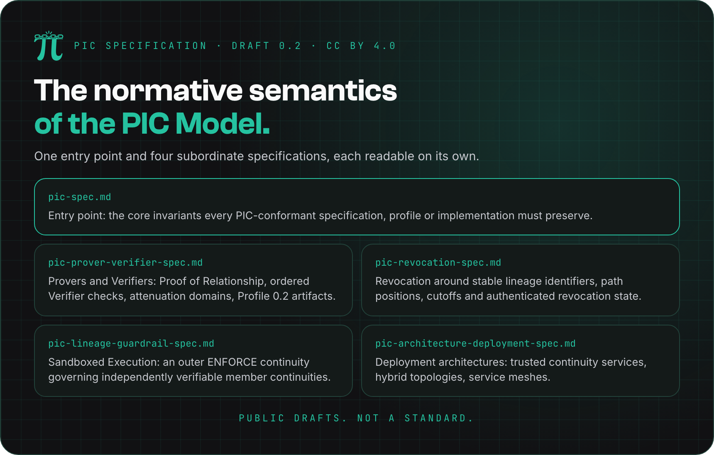
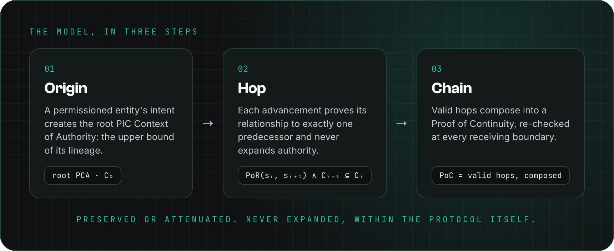

<p align="center">
  
</p>

<p align="center">
  <a href="https://www.pic-protocol.org/specification"><b>Read on the website</b></a> ·
  <a href="https://htmlpreview.github.io/?https://github.com/pic-protocol/pic-spec/blob/main/draft/0.2/rfc/pic-spec.html"><b>RFC-style HTML</b></a> ·
  <a href="https://www.pic-protocol.org/formal-model"><b>Formal model</b></a> ·
  <a href="NOTICE.md"><b>Notice</b></a>
</p>

# PIC Specification

This repository is the official home of the **PIC Specification**: the normative semantics of the **Provenance Identity Continuity (PIC) Model**.
It states, in implementation-independent requirements, what every PIC-conformant specification, profile or implementation must guarantee.
It is not a protocol itself: wire formats, transports, cryptographic suites and deployment choices belong to the protocols built on it.

> **Public drafts, not a standard.**
> These specifications are independently developed and have not been adopted, endorsed or published by a standards-development organization.
> They are published for review, research, experimentation and implementation feedback, and may be revised, replaced or withdrawn at any time.
> Any conformance claim applies only to the exact document version it names.

## The document set

Version 0.2 is published as six documents.
Each carries its own status, license notice, historical record and references, so it remains intelligible when distributed on its own.

| Document                                                                         | What it covers                                                                                                              | Status    |
| -------------------------------------------------------------------------------- | --------------------------------------------------------------------------------------------------------------------------- | --------- |
| [PIC Specification](draft/0.2/pic-spec.md)                                       | The entry point: core invariants, conformance language, and the index of subordinate specifications.                        | Draft 0.2 |
| [PIC Prover and Verifier](draft/0.2/pic-prover-verifier-spec.md)                 | Proof of Relationship, ordered Verifier checks, authority as an attenuation domain, and the Profile 0.2 artifacts.          | Draft 0.2 |
| [PIC Revocation](draft/0.2/pic-revocation-spec.md)                               | Revocation around stable lineage identifiers, path positions, depth and causal cutoffs, and authenticated revocation state. | Draft 0.2 |
| [PIC Sandboxed Execution](draft/0.2/pic-lineage-guardrail-spec.md)               | An outer `ENFORCE` continuity governing a collection of independently verifiable continuities, with no authority union.     | Draft 0.2 |
| [PIC Architecture and Deployment](draft/0.2/pic-architecture-deployment-spec.md) | Deployment architectures: trusted continuity services, hybrid enterprise topologies, service meshes.                        | Draft 0.2 |
| [Causally Ordered Security-State (COSS) Evidence Record](draft/0.2/coss-evidence-record-spec.md) | Transportable same-occurrence evidence for PIC, IFC, execution integrity, and other coordinates, supporting COSS PoR and PoC. | Draft 0.2 |

The Markdown under `draft/0.2/` is canonical.
Each document is also rendered as RFC-style XML, HTML and text under [`draft/0.2/rfc/`](draft/0.2/rfc); the rendering is a publication format and does not confer standards status.

## The core invariants

<p align="center">
  
</p>

A PIC-conformant specification, profile or implementation must preserve all of the following:

1. A root PIC Context of Authority establishes the upper authority bound for its lineage.
2. Every accepted non-root advancement continues exactly one causal predecessor.
3. The selected profile establishes the required **Proof of Relationship** (PoR) between predecessor and successor.
4. Successor authority is no greater than predecessor authority under the profile's attenuation order; for set-valued authority, it is a subset.
5. Authority from unrelated lineages is never imported into a valid continuation.
6. A **Proof of Continuity** is the composition of valid hops that preserve these invariants.

Authenticating artifacts, linking checkpoint bytes, proving control of a key, or enforcing non-expansion is not enough on its own to claim full PIC continuity.
An implementation that establishes only part of it may describe that part as a partial or `artifact-linked` assurance level, and must name what is missing.
The normative text, including execution contracts, multi-coordinate state, forks and joins, is in [`pic-spec.md`](draft/0.2/pic-spec.md#core-invariants).

## Where the Specification sits

<p align="center">
  
</p>

- The **PIC Model** publications remain authoritative for the theoretical framework; this Specification is authoritative for normative requirements and conformance language.
- A **PIC Protocol** is PIC-compliant if and only if it implements a declared version of this Specification and preserves the invariants of the PIC Model.
- An **implementation** is PIC-compliant if it correctly implements a PIC-compliant protocol, or, where no protocol is published, directly implements a declared version of this Specification.
- Subordinate specifications must not redefine, extend or alter the PIC Model invariants, and must name the version of this Specification they depend on.

No PIC Protocol specification has been published yet.
[PIC-X](https://github.com/pic-protocol/pic-x) 0.2.3 implements the current centralized Profile 0.2 subset at the `artifact-linked` assurance level; it does not implement full semantic PoR, request or execution binding, causal attribution, revocation, or Sandboxed Execution.

## Repository layout

| Path                                                        | Contents                                                          |
| ----------------------------------------------------------- | ----------------------------------------------------------------- |
| [`draft/0.2/`](draft/0.2)                                   | The current specification set, in kramdown-rfc Markdown.          |
| [`draft/0.2/rfc/`](draft/0.2/rfc)                           | The generated RFC-style XML, HTML and text, committed.            |
| [`draft/0.2/ontology-for-llm/`](draft/0.2/ontology-for-llm) | The LLM context file, used by the website's *Ask Your LLM* pack.  |
| [`draft/0.2/notes/`](draft/0.2/notes)                       | Informative notes, such as the scope boundary with the A2A layer. |
| [`draft/0.1/`](draft/0.1)                                   | The earlier 0.1 drafts, kept for the record.                      |
| [`scripts/rfc/`](scripts/rfc)                               | The RFC build pipeline and the list of documents it builds.       |

## Building RFC documents

The specifications under `draft/0.2/` are authored in kramdown-rfc markdown and compile to RFC-style
XML (RFCXML v3), HTML, and plain text next to their sources, under `draft/<version>/rfc/`, which is
committed. The pipeline uses
[kramdown-rfc2629](https://github.com/cabo/kramdown-rfc) (Ruby) and [xml2rfc](https://github.com/ietf-tools/xml2rfc)
(Python), both installed locally under `.tools/` — nothing is installed system-wide and `sudo` is never used.

Prerequisites: [Task](https://taskfile.dev), `python3`, and a Ruby ≥ 3.0 (e.g. `brew install ruby`; the
setup script finds the Homebrew Ruby automatically and never uses the macOS system Ruby for gems).

```sh
task rfc:setup     # one-time (idempotent): kramdown-rfc into .tools/gems, xml2rfc into .tools/xml2rfc-venv
task rfc:check     # verify toolchain + validate all configured specs (no outputs written)
task rfc:build     # build draft/<version>/rfc/<name>.{xml,html,txt} for every spec in scripts/rfc/sources.txt
task rfc:clean     # remove generated outputs and logs
task rfc:rebuild   # clean + build
```

Builds are atomic per document: outputs land in the version's `rfc/` directory only if that document converts and renders without errors;
per-document logs are written to `.cache/rfc-logs/`. The list of specifications to build is `scripts/rfc/sources.txt`.

In the generated HTML, cross-references between the built specs are relative `.html` links, so the
set is navigable wherever it is served: a static host, a local checkout, or directly from GitHub via
[htmlpreview](https://htmlpreview.github.io/), e.g.
`https://htmlpreview.github.io/?https://github.com/pic-protocol/pic-spec/blob/main/draft/0.2/rfc/pic-spec.html`.
Each document's *Source* link keeps pointing to the canonical markdown on GitHub. When a new draft version is created (e.g. `draft/0.3/`),
add its specifications to `sources.txt` and keep the old versions listed: a single
`task rfc:build` then rebuilds every configured version — `draft/0.2/rfc/`, `draft/0.3/rfc/`, and so on.

## Origin and research record

The PIC Model was originally developed by **Nicola Gallo**.
Its dated research history and primary publications, from the first working paper of 1 December 2025 to the event-level causal closure of 2 October 2026, are recorded in [Origins, Authorship, and Historical Record](draft/0.2/pic-spec.md#origins-authorship-and-historical-record).
The PIC Specifications are published and maintained by **Nitro Agility S.r.l.** as Specification Steward.
Researchers and implementers are encouraged to cite the primary publication that supports the formal property they discuss.

## License

The specification materials are licensed under the **Creative Commons Attribution 4.0 International (CC BY 4.0)** license.
See [`LICENSE`](LICENSE) for the full terms, and [`NOTICE.md`](NOTICE.md) for origin, stewardship, attribution and canonical-version information; the notice does not add restrictions to the license.

## Governance and contributions

| Document                                   | Purpose                                  |
| ------------------------------------------ | ---------------------------------------- |
| [`GOVERNANCE.md`](GOVERNANCE.md)           | How the specifications are governed.     |
| [`CONTRIBUTING.md`](CONTRIBUTING.md)       | How to propose a change.                 |
| [`NOTICE.md`](NOTICE.md)                   | Origin, stewardship and attribution.     |
| [`CODE_OF_CONDUCT.md`](CODE_OF_CONDUCT.md) | The Contributor Covenant.                |
| [`MAINTAINERS.md`](MAINTAINERS.md)         | The Maintainer role.                     |
| [`SECURITY.md`](SECURITY.md)               | How to report a vulnerability privately. |

Issues and pull requests on this repository are the place for technical discussion.
Repository process and legal information stay in these conventional files, so the specifications themselves can be carried into a future standards process without a separate legal appendix.
